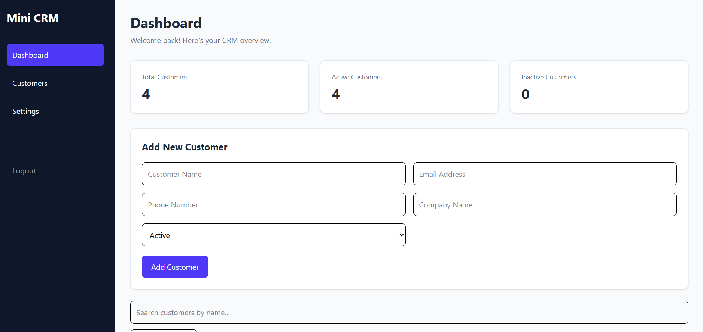
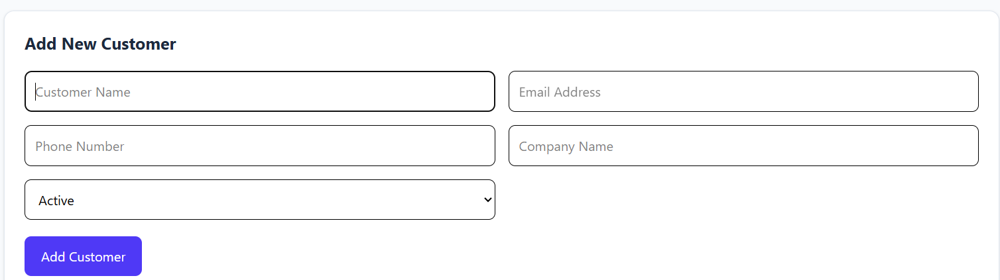
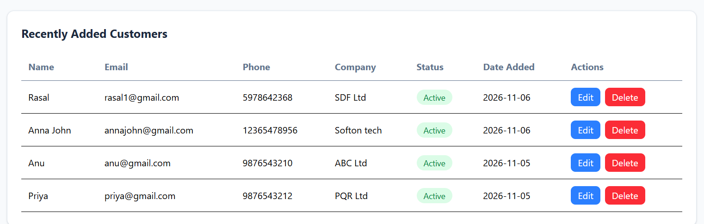
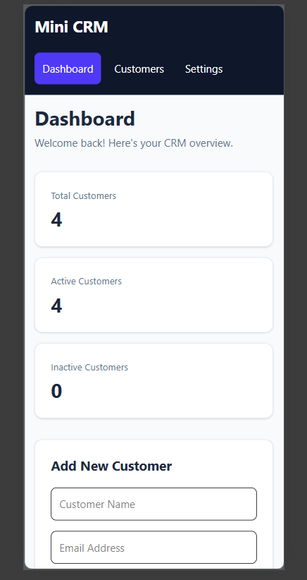

# Mini CRM Dashboard

A responsive Customer Relationship Management (CRM) dashboard built using React.js, JavaScript, Tailwind CSS and LocalStorage.

## Features

- Dashboard statistics: total, active and inactive customers
- Add new customers
- Edit customer details
- Delete customers
- Search customers by name
- Filter customers by status
- Form validation
- Save customer data using browser LocalStorage
- Responsive design for mobile, tablet and desktop
- Recently added customers section

## Technologies Used

- React.js
- JavaScript
- Tailwind CSS
- Vite
- Browser LocalStorage

## Installation and Setup

1. Clone the repository:

   ```bash
   git clone YOUR_GITHUB_REPOSITORY_URL
   ```

2. Navigate to the project folder:

   ```bash
   cd mini-crm
   ```

3. Install dependencies:

   ```bash
   npm install
   ```

4. Start the development server:

   ```bash
   npm run dev
   ```

5. Open the local URL shown in the terminal.

## Data Storage

Customer information is stored in the browser's LocalStorage. Data remains available after refreshing the page in the same browser.

## Screenshots

### Dashboard


### Add Customer


### Customer Table


### Mobile Responsive View


## Author

Varsha K A